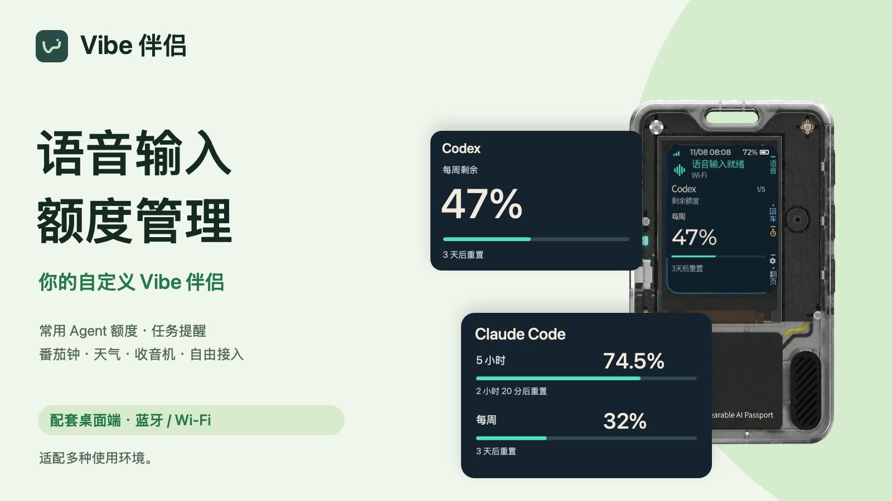
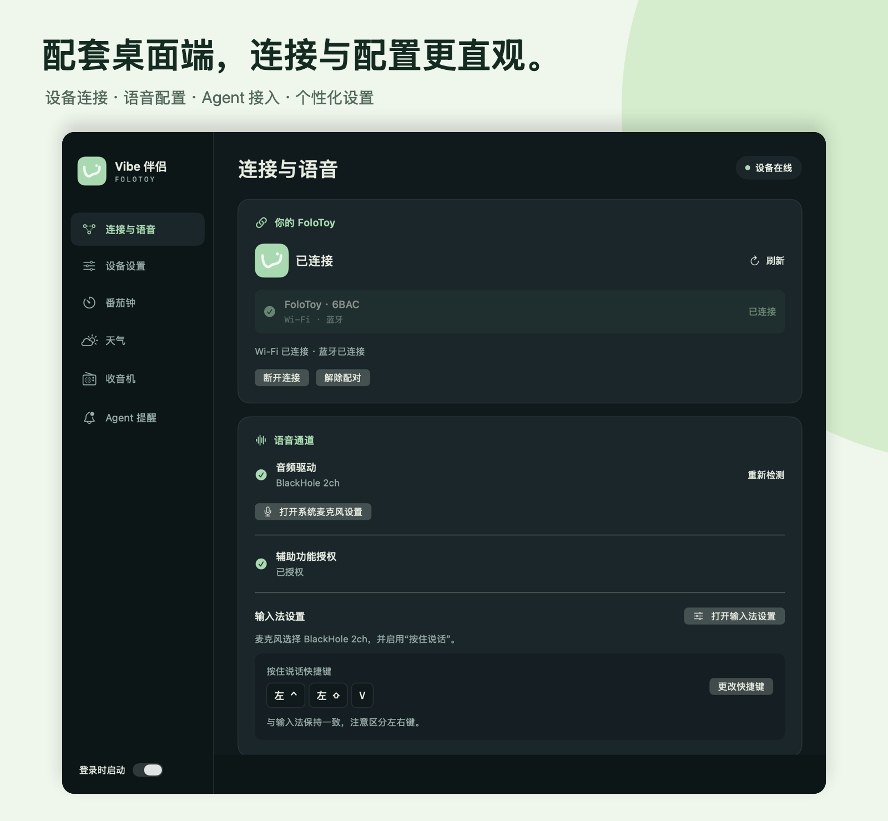
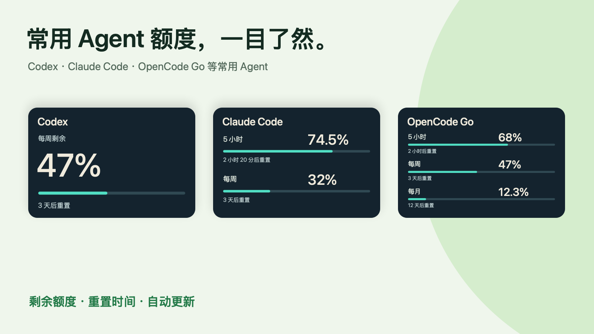
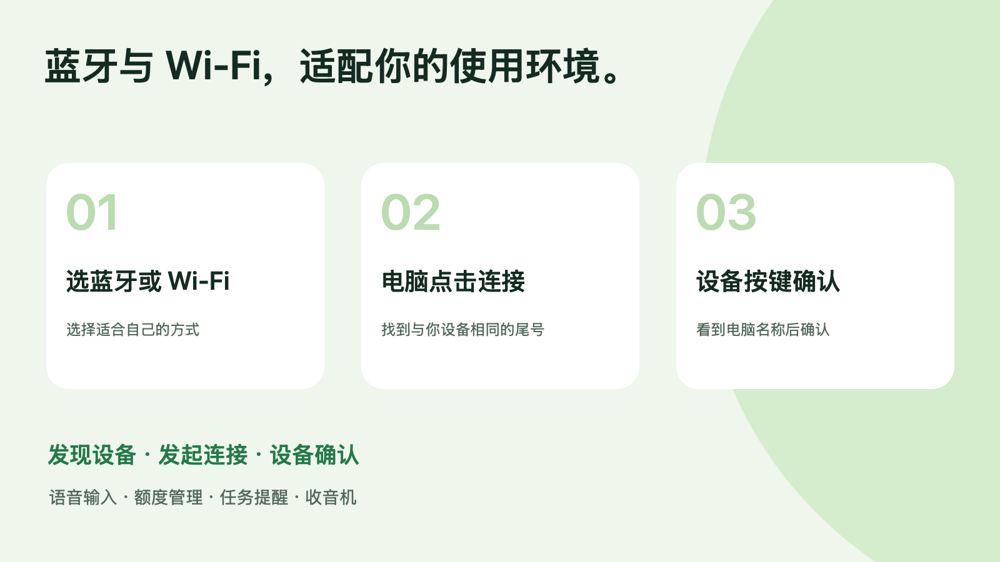

**English** · [简体中文](README.md)

# Vibe Companion

**Voice input. AI quota management. Your own Vibe companion.**

**A major voice-stability upgrade for both dual-link and single-link input.**

Bring remaining allowances and task alerts from everyday Agents such as Codex, Claude Code and OpenCode Go to AI Passport beside you. Express ideas with voice input and keep quotas and task status in view, so you can focus on the work in front of you.

## Two links working together, so you can keep speaking

Voice delivery has been reworked for a wider range of network conditions. Stronger short-term buffering and missing-audio recovery reduce interruptions from brief jitter and congestion, while recording takes priority in the audio workspace.

Send voice over Wi-Fi and Bluetooth at the same time. The computer merges the audio and removes duplicate copies. When one link briefly drops a packet, the other can fill the gap. If one disconnects, a usable surviving link can keep carrying your voice, reducing interruptions and missing speech.

Using only Wi-Fi or Bluetooth also benefits from short audio history and missing-block repair. Choose the connection that fits your office, home or other environment.
Dual-link voice requires both links to be connected and matching updated firmware and desktop software.

## A desktop app that keeps setup together

Discover and connect devices, configure voice input, integrate Agents and adjust everyday settings in one companion app. Keep the device beside you and manage it from your computer.

## Keep your attention on creating

| The experience | What it brings you |
| --- | --- |
| More natural input | Use your voice to enter ideas on your computer and reduce long stretches of typing. |
| More continuous speech | Wi-Fi and Bluetooth back each other up, reducing the impact of brief packet loss or a single-link disconnection. |
| Less checking, timely alerts | The device lights up when a task finishes, needs approval or asks a question. |
| Allowances at a glance | See remaining allowances and reset times from your everyday Agents, updated automatically. |
| A fit for your workflow | Set up built-in integrations with a click, or connect your own Agent for alerts and quotas. |

## Agent alerts and quotas

| Agent | Alerts | Quotas |
| --- | --- | --- |
| Codex | Completion, approval, supported tool questions | Reuses the existing login and available allowance windows |
| Claude Code | Completion, approval, questions | Five-hour and weekly allowances from status-line callbacks |
| OpenCode | Completion, approval, questions, failure | Go five-hour, weekly and monthly allowances |
| DeepSeek Harness, ZCode, Gemini CLI, Qwen Code | Built-in integrations; see event coverage | Real quota data can be added through custom callbacks |
| Your own Agent | Task events through local callbacks | Percentages, multiple windows, model quotas or monetary balances |

Install built-in integrations in the desktop app and reuse your existing Agent login. To connect your own Agent, copy the app's prompt and let your coding Agent add alert and quota callbacks.
Fields depend on the data each Agent provides. Unavailable data is quietly skipped. [Agent integration](docs/vibe/agents.md) · [Quota guide](docs/vibe/quotas.md)

## More beside you

Focus with a Pomodoro timer, browse weather or enjoy the radio. Radio pauses for voice input and resumes afterward. Adjust appearance, city, stations and everyday settings in the desktop app.

## Start in three steps

1. **Install.** Flash firmware from the [FoloToy play page](https://ai-passport.folotoy.cn/plays/2174/) and download the desktop app from [GitHub Releases](https://github.com/lialun/folotoy-vibe-companion/releases).
2. **Connect.** Choose Bluetooth or Wi-Fi, click Connect in the app, and confirm on the device.
3. **Enable.** Install Agent integrations. Follow the app's guide for voice input, audio and shortcut setup.

[Installation and permissions](docs/vibe/install.md) · [Device connection](docs/vibe/connections.md) · [Features and buttons](docs/vibe/README.md)

The current desktop app supports macOS 13 and later on Apple Silicon and Intel. Speech recognition uses a compatible input method. Keep the computer awake and the app running; the computer fetches radio and online quota data.

## Credits and license

Built on the official [FoloToy AI Passport](https://github.com/FoloToy/ai-passport)
firmware and BSP, with references from
[passport-os](https://github.com/manchunx7-bit/passport-os) and
[folo-ai-passport-voice](https://github.com/manchunx7-bit/folo-ai-passport-voice).
Agent adapters draw on [agent-notify](https://github.com/hellolib/agent-notify),
[agent-notify-dsh](https://github.com/wanfanggreat/agent-notify-dsh), and
[PeonPing](https://github.com/PeonPing/peon-ping).
Weather: [Open-Meteo](https://open-meteo.com/). Station search:
[Radio Browser](https://www.radio-browser.info/).

A community project, not an official FoloToy release. Project code is
[MIT licensed](LICENSE). Fonts, icons, and firmware dependencies retain their
respective licenses; release packages include third-party notices.
See [asset and license records](assets/README.md).
