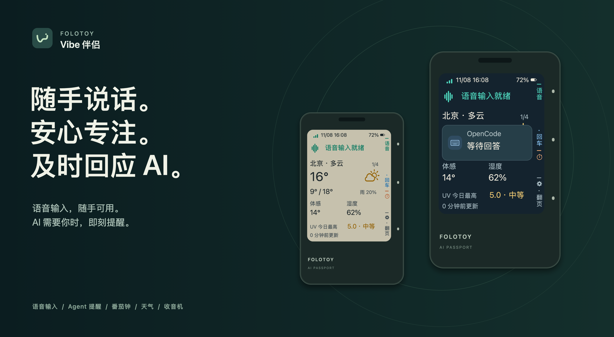
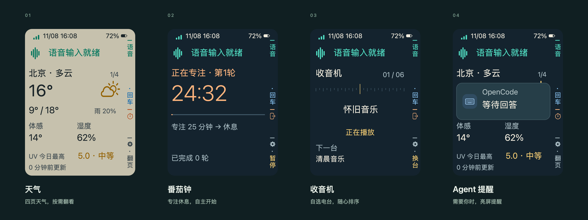
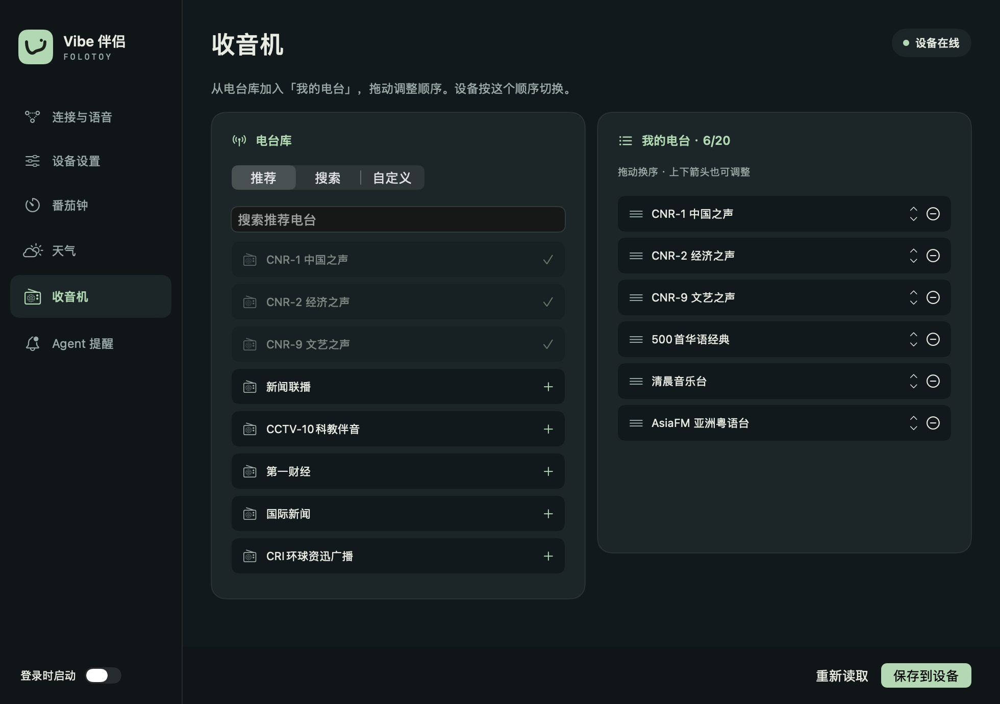
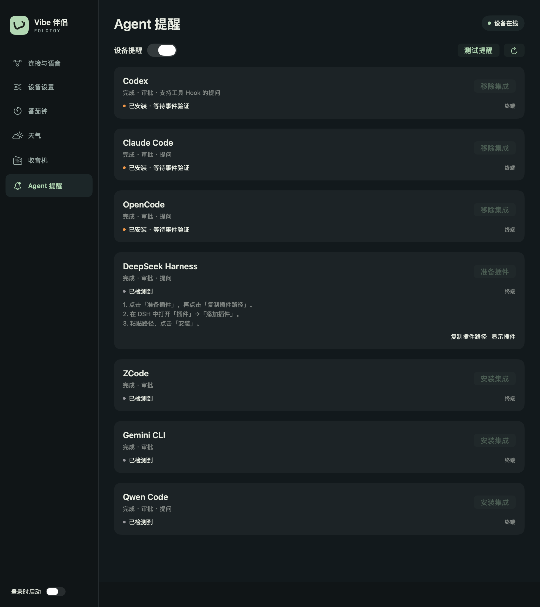

**English** · [简体中文](README.zh_CN.md)

# FoloToy Vibe Companion

**A small companion for your voice, your focus, and your AI agents.**

Turn a FoloToy AI Passport into a wireless dictation device and an Agent notifier.
Hold a button to speak into your computer. Get a screen wake and a chime when an
Agent finishes or needs your attention. Keep a timer, weather, or radio nearby.

**The desktop app currently supports macOS 13+ only (Apple Silicon / Intel).
Windows is not supported yet.**



[Download](https://github.com/lialun/folotoy-vibe-companion/releases/latest) · [Get started](docs/vibe/README.md) · [Install the desktop app](docs/vibe/install.md) ·
[Agent integrations](docs/vibe/agents.md) · [Design](docs/vibe/DESIGN.md)

## What it does

| Feature | Experience |
| --- | --- |
| **Speak from your desk** | Hold UP to dictate, release to finish, tap DOWN to insert Enter. Useful with a closed laptop when the computer remains awake. |
| **Know when your Agent needs you** | Screen and sound alerts for completion, approval, questions, or errors, depending on the Agent. The compact notice disappears after five seconds; a button dismisses it and still performs its usual action. |
| **Stay with your focus** | Start, pause, and resume a Pomodoro with one button. Each completed phase leads to the next, waiting for you to start it. Voice remains available. |
| **Glance at the weather** | Current conditions, six-hour temperature and rain, air quality and wind, and a three-day forecast. Turn pages manually, with light and dark themes. |
| **Listen to your stations** | Play Internet radio on the device. Search, check, add, and reorder stations in the desktop app. Speaking interrupts radio; listening reconnects afterwards. |
| **Leave configuration to the computer** | Adjust brightness, volume, themes, timer durations, and weather city. The client lives in the menu bar and leaves the Dock when its window closes. |



The lower screen has one active module: weather, Pomodoro, or radio. Voice stays
at the top. A narrow rail explains the three physical buttons in each context.

## A desktop app for the details

The native macOS app brings device settings, station management, and Agent
integrations together. Search stations, check custom streams, drag to reorder,
and save the list to your device. Close the window to keep it in the menu bar
without a Dock icon; open it again when needed.



## Agent integrations

**Codex · Claude Code · OpenCode · DeepSeek Harness · ZCode · Gemini CLI · Qwen Code**

The desktop app detects supported local installations and installs their hooks
or plugins. Notifications travel through the companion to the device; no extra
push service account is needed. Coverage depends on the Agent, version, and entry
point. Local hooks do not cover remote/cloud sessions automatically.
See the [integration guide](docs/vibe/agents.md) for supported events, installation,
and verification.



## Get started

You need a **FoloToy AI Passport**, **macOS 13 or later**, and a reachable local
network. The app is a **universal binary for Apple Silicon and Intel**. Voice input
also requires [BlackHole 2ch](https://existential.audio/blackhole/) and
[WeType](https://z.weixin.qq.com/) or another compatible hold-to-talk input method.

1. **Install the matching firmware and app** from this repository's GitHub
   Releases. Flash the merged firmware at `0x0` and place the app in Applications.
   Follow the [setup guide](docs/vibe/README.md) before flashing.
2. **Connect the device to Wi-Fi.** Join its setup hotspot with your phone and
   select a 2.4 GHz network. It remembers up to five networks and reconnects
   automatically when you move between them.
3. **Pair the device.** Enter its pairing code in the app. For voice input,
   select BlackHole 2ch in your input method, match the hold-to-talk shortcut,
   and grant the app keyboard-control permission. Agent-only use does not need
   voice setup. The [Mac installation guide](docs/vibe/install.md) covers first
   launch and permissions.
4. **Add the Agents you use.** Install integrations in **Agent notifications**,
   review any trust prompt in the Agent, then verify a real event.

The device sends microphone audio over the LAN; the input method performs speech
recognition under its own settings and service terms. This is not a generic USB
or Bluetooth microphone. Dictation and Agent delivery require the companion to
be running and the computer awake; the timer and weather work without it.

## Platform and compatibility

- **Available implementation:** ESP32-C3 firmware and a macOS client. Windows and
  Linux clients are not implemented.
- **Validation limits:** Apple Silicon and the target device have been exercised
  during development. The Intel binary is cross-built; a physical Intel Mac and
  clean-machine installation still need verification. Radio availability depends
  on the station, stream format, network, and device resources.

## Build and contribute

Firmware uses **ESP-IDF 5.5.3**; the desktop client uses **Swift, SwiftUI, and
AppKit**. No Electron runtime is bundled.

```bash
# Repository checks and host tests; no device required
./tools/validate.sh --static

# Firmware build and verified merged image; activate ESP-IDF 5.5.3 first
./tools/validate.sh

# Universal macOS app, native tests, DMG and ZIP; run on a Mac
bash macos/build.sh
```

[Build and packaging](docs/vibe/release.md) ·
[Interaction, UI, and memory conventions](docs/vibe/DESIGN.md) ·
[Contributing](.github/CONTRIBUTING.md) · [Support](.github/SUPPORT.md)

## Credits and license

Built on the official [FoloToy AI Passport](https://github.com/FoloToy/ai-passport)
firmware and BSP, with references from
[passport-os](https://github.com/manchunx7-bit/passport-os) and
[folo-ai-passport-voice](https://github.com/manchunx7-bit/folo-ai-passport-voice).
Agent adapters draw on [agent-notify](https://github.com/hellolib/agent-notify),
[agent-notify-dsh](https://github.com/wanfanggreat/agent-notify-dsh), and
[PeonPing](https://github.com/PeonPing/peon-ping).
Weather: [Open-Meteo](https://open-meteo.com/). Station search:
[Radio Browser](https://www.radio-browser.info/).

A community project, not an official FoloToy release. Project code is
[MIT licensed](LICENSE). Fonts, icons, and firmware dependencies retain their
respective licenses; release packages include third-party notices.
See [asset and license records](assets/README.md).
