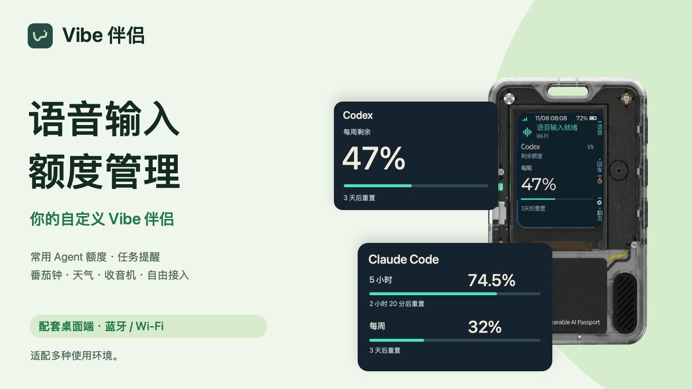
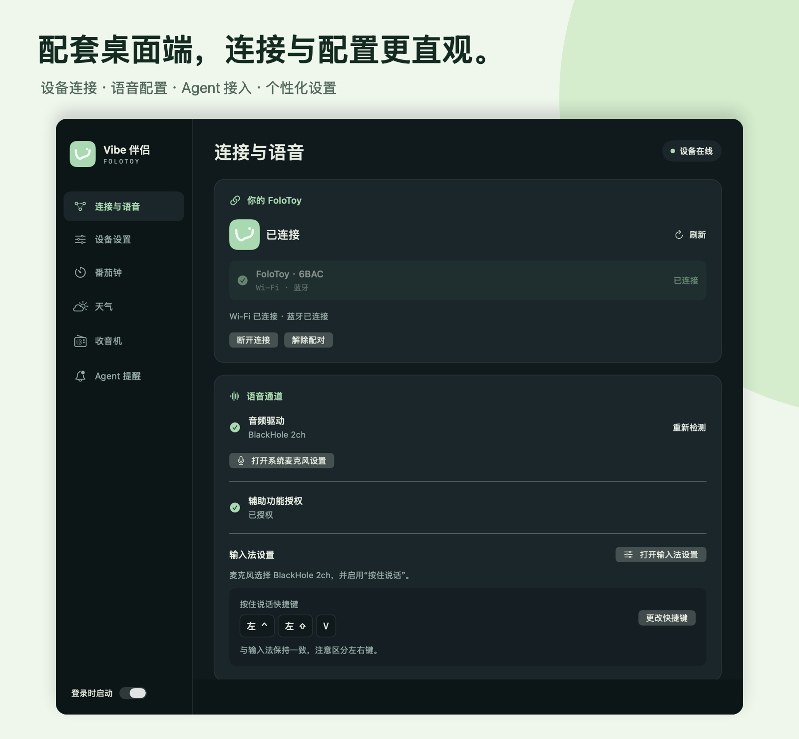
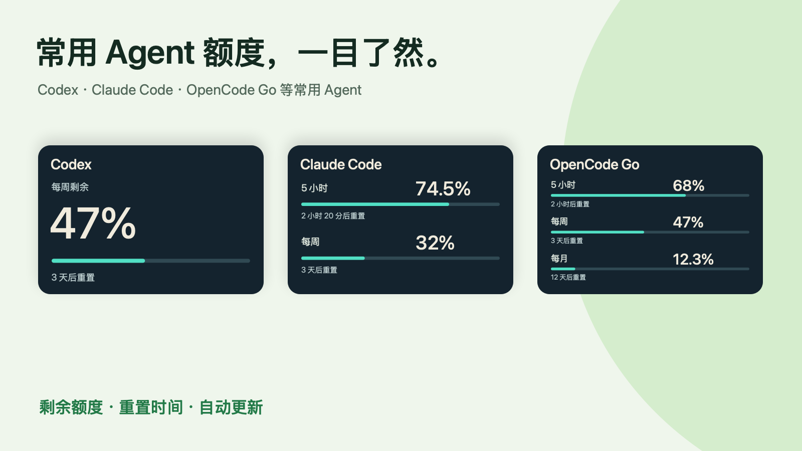
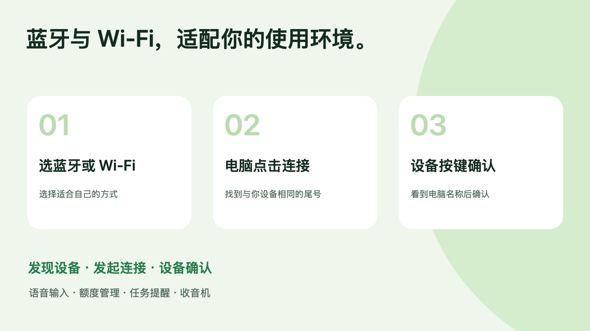

[English](README.en.md) · **简体中文**

# Vibe 伴侣

**语音输入 · 额度管理，你的自定义 Vibe 伴侣。**



把 Codex、Claude Code、OpenCode Go 等常用 Agent 的剩余额度与任务提醒，集中到桌边的 AI 护照上。用语音表达想法，用小屏掌握额度与任务状态，让注意力留给正在做的事。

**蓝牙与 Wi-Fi 双连接，适配多种使用环境。**

## 配套桌面端，让连接与配置更直观

从设备发现、连接确认，到语音配置、Agent 接入，常用设置都集中在配套 App。设备放在手边，配置在电脑上完成。



## 把注意力留给创作

| 核心体验 | 为你带来的改变 |
| --- | --- |
| 语音输入，表达更自然 | 用语音把想法输入电脑，减少长段文字输入的负担。 |
| 任务提醒，减少来回查看 | 任务完成、等待审批或需要回答时，设备亮屏提醒。 |
| 额度管理，余量一目了然 | 常用 Agent 的剩余额度与重置时间集中展示，自动更新。 |
| 自由接入，适配你的工作流 | 常用 Agent 一键集成，也能接入自己的 Agent，拓展提醒与额度展示。 |



## Agent 提醒与额度

| Agent | 提醒 | 额度 |
| --- | --- | --- |
| Codex | 完成、审批、支持工具 Hook 的提问 | 复用已有登录，展示账户提供的额度窗口 |
| Claude Code | 完成、审批、提问 | 从状态栏回调采集五小时／每周额度 |
| OpenCode | 完成、审批、提问、失败 | Go 套餐五小时／每周／每月额度 |
| DeepSeek Harness、ZCode、Gemini CLI、Qwen Code | 支持内置提醒集成，事件范围见文档 | 可通过自定义回调接入真实额度 |
| 自己的 Agent | 支持本机回调的任务提醒 | 支持百分比、多个窗口、模型额度或金额余额 |

在桌面端安装常用 Agent 集成，沿用已有登录。想接入自己的 Agent，复制 App 内的提示词交给大模型，完成提醒与额度回调适配。
具体字段取决于 Agent 提供的数据，获取不到时安静跳过。[查看接入说明](docs/vibe/agents.zh_CN.md) · [额度说明](docs/vibe/quotas.zh_CN.md)

## 不止工作提醒

番茄钟帮你专注，天气随手可看，收音机陪你休息。语音输入时电台暂停，结束后自动恢复。外观、城市、电台和日常设置都能在桌面 App 调整。

## 三步开始

1. **安装。** 从 [FoloToy 玩法页](https://ai-passport.folotoy.cn/plays/2174/) 刷入固件，从 [GitHub Releases](https://github.com/lialun/folotoy-vibe-companion/releases) 下载桌面 App。
2. **连接。** 选择蓝牙或 Wi-Fi，在电脑点击设备“连接”，再在设备上按键确认。
3. **开启。** 安装 Agent 集成；语音输入按 App 内引导完成音频和快捷键设置。



[安装与授权](docs/vibe/install.zh_CN.md) · [设备连接](docs/vibe/connections.zh_CN.md) · [功能与按键](docs/vibe/README.zh_CN.md)

当前桌面端支持 macOS 13 及以上，兼容 Apple Silicon 和 Intel。语音识别由兼容的输入法提供。使用时保持电脑唤醒、App 运行；收音机和在线额度由电脑联网获取。

## 开发与贡献

固件使用 **ESP-IDF 5.5.3**，客户端使用 **Swift、SwiftUI 和 AppKit**，不打包 Electron。

```bash
# 仓库检查与主机测试，不需要设备
./tools/validate.sh --static

# 完整验证与合并固件构建；先激活 ESP-IDF 5.5.3
./tools/validate.sh

# macOS 通用 App、原生测试、DMG 和 ZIP；在 Mac 上运行
bash macos/build.sh
```

[构建与打包](docs/vibe/release.zh_CN.md) ·
[交互、UI 与内存规范](docs/vibe/DESIGN.zh_CN.md) ·
[参与贡献](.github/CONTRIBUTING.zh_CN.md) · [反馈问题](.github/SUPPORT.zh_CN.md)

## 致谢与许可

基于官方 [FoloToy AI Passport](https://github.com/FoloToy/ai-passport) 固件及 BSP，参考
[passport-os](https://github.com/manchunx7-bit/passport-os) 和
[folo-ai-passport-voice](https://github.com/manchunx7-bit/folo-ai-passport-voice)。
Agent 接入参考 [agent-notify](https://github.com/hellolib/agent-notify)、
[agent-notify-dsh](https://github.com/wanfanggreat/agent-notify-dsh) 和
[PeonPing](https://github.com/PeonPing/peon-ping)。天气来自
[Open-Meteo](https://open-meteo.com/)，电台搜索使用
[Radio Browser](https://www.radio-browser.info/)。

这是社区项目，并非 FoloToy 官方发行版。项目代码采用 [MIT 许可](LICENSE)，
字体、图标和固件依赖保留各自许可，发行包附带第三方声明。
详见[素材与许可记录](assets/README.zh_CN.md)。
